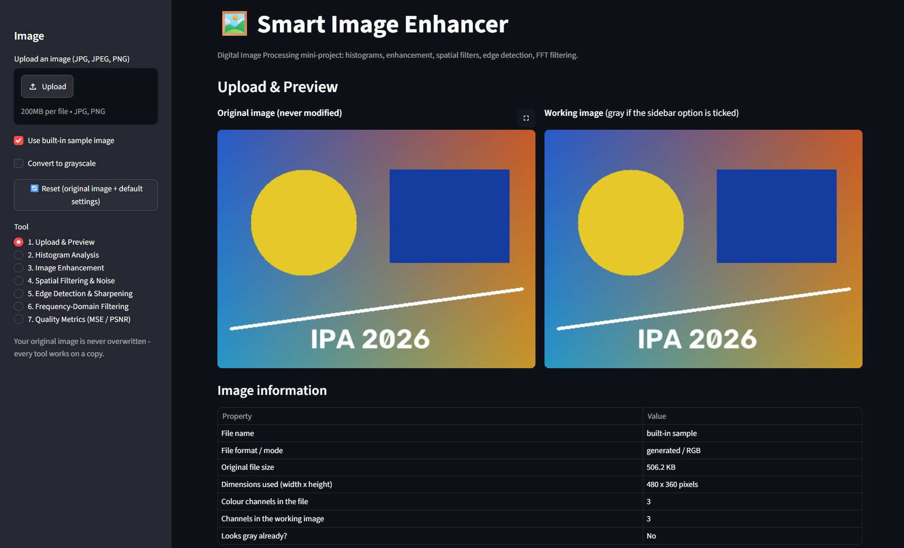
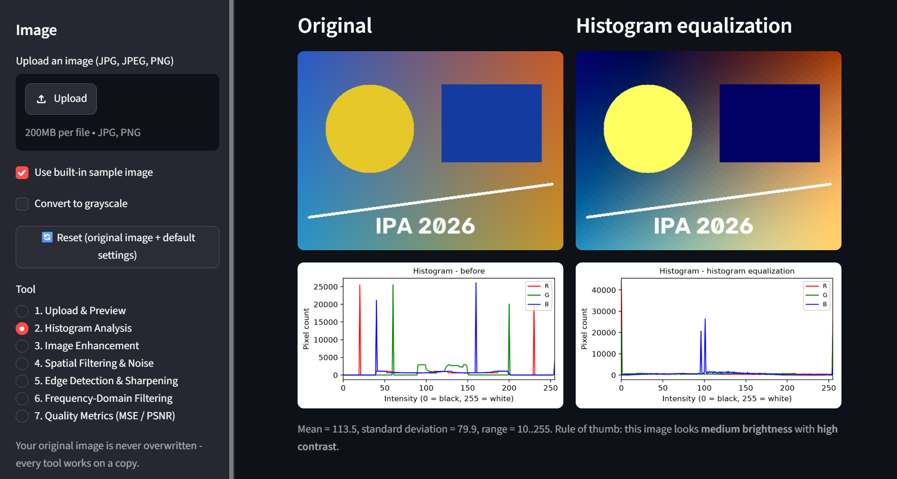
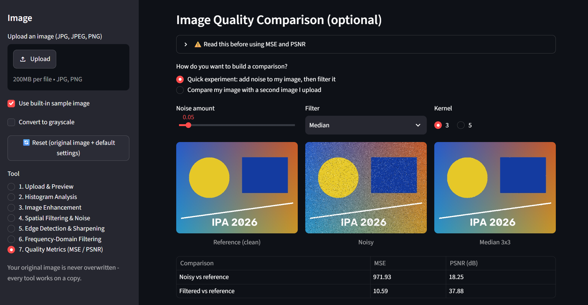
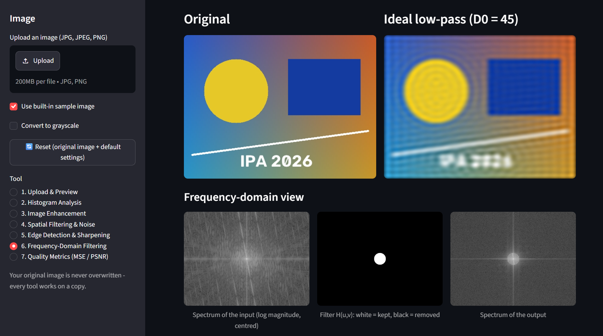

# Smart Image Enhancer

An interactive **Digital Image Processing** web application built with Python and Streamlit for the
*Image Processing and Applications (IPA)* course. Upload an image (or use the built-in sample), apply
classical image-processing techniques, and compare the original and processed results side by side.
Everything runs locally: no internet connection, API key, GPU or database is needed while the app is running.

> The application demonstrates **classical** image processing only. It does not use machine learning.

**Author:** Subhronil Biswas, Roll No. 24155661, B.Tech CSE (AI & ML), School of Computer Science and Engineering, KIIT
Section IPA 11, 5th Semester, 2026-27. **Faculty-in-Charge:** Dr. Sricheta Parui.

## Features

| Section in the app | What it does |
|---|---|
| 1. Upload & Preview | JPG / JPEG / PNG upload (or built-in sample), image information, grayscale option, reset, original never overwritten |
| 2. Histogram Analysis | Gray and RGB histograms, plain-language reading (mean, standard deviation, range), before / after histograms |
| 3. Image Enhancement | Negative, logarithmic, gamma, contrast stretching, histogram equalization, gray-level slicing, bit-plane slicing |
| 4. Spatial Filtering & Noise | Salt-and-pepper noise; mean, median, maximum, minimum, midpoint, alpha-trimmed mean and weighted mean filters (3x3, 5x5, 7x7); compare-all table |
| 5. Edge Detection & Sharpening | Sobel X / Y / magnitude, Laplacian edges, Laplacian sharpening, unsharp masking, high-boost filtering |
| 6. Frequency-Domain Filtering | 2-D FFT spectrum; ideal, Butterworth and Gaussian low-pass and high-pass filters with adjustable cutoff and order |
| 7. Quality Metrics | MSE and PSNR for a noise-and-filter experiment or against a second uploaded image |

Every tool shows its formula in a "How it works" box, validates its parameters, and offers a PNG download of the result.

## Screenshots

| Interface | Histogram equalization |
|---|---|
|  |  |

| Median filter with MSE / PSNR | Ideal low-pass filter (FFT) |
|---|---|
|  |  |

More screenshots are in [`assets/screenshots/`](assets/screenshots/).

## Quick start

Requires **Python 3.11 or 3.12** (64-bit).

```bash
git clone https://github.com/<your-username>/smart-image-enhancer.git
cd smart-image-enhancer
python -m venv .venv
```

Activate the virtual environment:

```bash
# Windows (PowerShell)
.venv\Scripts\Activate.ps1
# Windows (Command Prompt)
.venv\Scripts\activate.bat
# macOS / Linux
source .venv/bin/activate
```

Install the dependencies and start the application:

```bash
python -m pip install -r requirements.txt
python -m streamlit run app.py
```

Streamlit prints a local address and normally opens your browser automatically. If it does not, open
**http://localhost:8501**. Press `Ctrl + C` in the terminal to stop the app.

If PowerShell refuses to run `Activate.ps1`, run `Set-ExecutionPolicy -Scope CurrentUser -ExecutionPolicy RemoteSigned`
once, or use the Command Prompt command above.

## How to use the application

1. In the sidebar, upload a JPG / PNG image, or tick **Use built-in sample image**.
2. Choose a tool under **Tool** (1 to 7). Adjust the sliders and drop-down lists; the result updates immediately.
3. Compare **Original** and **Processed** images; open **How it works** for the formula.
4. Use **Download processed image (PNG)** to save a result.
5. Tick **Convert to grayscale** to work on a gray copy; press **Reset** to return to the original image and default settings.

Suggested first experiment: open *4. Spatial Filtering & Noise*, tick **Add salt-and-pepper noise**, choose **Median** (3x3),
and compare the MSE of the noisy and filtered images against the clean original.

## Run the automated tests

```bash
python -m unittest discover -s tests -v
```

The suite contains **63 tests** (point transforms, spatial filters, Sobel / Laplacian, FFT filtering, MSE / PSNR, file loading).
Expected result: `Ran 63 tests ... OK`.

## Project structure

```
smart-image-enhancer/
├── app.py                  Streamlit interface (seven page functions); no algorithm code
├── image_processing.py     Intensity transforms, spatial filters, Sobel, Laplacian, sharpening, noise
├── frequency_filters.py    FFT pipeline, centred spectrum, ideal / Butterworth / Gaussian filters
├── utils.py                Image loading and validation, PNG export, MSE / PSNR, histogram plots, sample image
├── explanations.py         Formulas and explanations shown inside the app
├── tests/test_algorithms.py   63 unit tests (standard-library unittest)
├── assets/screenshots/     Screenshots of the running application
├── requirements.txt
└── README.md
```

## Implementation notes

* **Implemented from the formulas (NumPy):** negative, log, gamma, contrast stretching, histogram equalization, slicing,
  all seven spatial filters, Sobel, Laplacian, the FFT filtering pipeline, MSE and PSNR.
* **Library calls:** RGB-to-gray and RGB / YCrCb conversion and the Gaussian blur used in unsharp masking and high-boost
  (OpenCV), the FFT itself (`numpy.fft`), image file reading (Pillow), histogram figures (Matplotlib).
* All calculations use floating point and are rounded and clipped to 0..255, so 8-bit values cannot wrap around.
* Neighbourhood filters use reflect padding; frequency filters zero-pad the image to twice its size by default.
* Images whose longer side exceeds 800 px are shrunk automatically so the filters stay fast. Files above 25 MB are rejected
  (the Streamlit uploader itself shows a generic 200 MB limit).
* For the built-in sample image, "Original file size" is the size of the generated pixel array in memory
  (480 x 360 x 3 bytes), because there is no file on disk.
* The noise seed is 42 by default on the Spatial Filtering page and fixed at 7 on the Quality Metrics page, so the two pages
  show slightly different MSE values for the same noise amount.

## Limitations

8-bit images only; salt-and-pepper is the only simulated noise; MSE / PSNR need a same-size reference and do not measure
perceived quality; the NumPy neighbourhood filters are slower than OpenCV's optimised versions on large images.

## Troubleshooting

| Problem | Fix |
|---|---|
| `streamlit` or `python` is not recognised | Activate the virtual environment, or use `python -m streamlit run app.py`; on Windows try `py` instead of `python`. |
| `No module named cv2` / `numpy` | Run `python -m pip install -r requirements.txt` with the virtual environment active. |
| Package installation fails | Use 64-bit Python 3.11 or 3.12. |
| Port 8501 is busy | `python -m streamlit run app.py --server.port 8502` |
| "This file could not be read as an image" | The file is corrupted or not a real JPG / PNG. |

## Acknowledgement

The source code, the unit tests and the documentation of this project were generated with the assistance of an AI tool
(Claude, by Anthropic) from requirements specified by the author. The author ran the application and the tests locally and
supplied the screenshots. The algorithms are standard textbook techniques; OpenCV, NumPy, Pillow, Matplotlib and Streamlit
provide the underlying library functionality.
